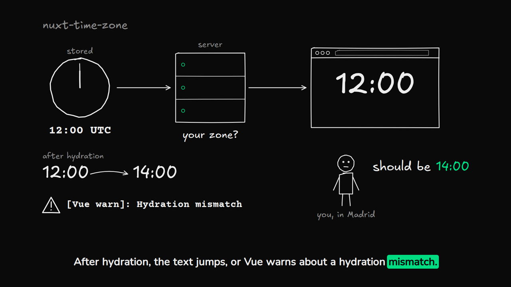

<h1>
  <picture>
    <source media="(prefers-color-scheme: dark)" srcset="./.github/assets/banner-dark.svg">
    <source media="(prefers-color-scheme: light)" srcset="./.github/assets/banner-light.svg">
    
  </picture>
</h1>

[](https://github.com/onmax/nuxt-time-zone/actions/workflows/ci.yml)
[](#status)
[](https://nuxt.com)
[](./LICENSE)

The visitor's time zone, the same on the server and the client. No hydration mismatches on dates.

[](./.github/assets/explainer.mp4)

## Install

```sh
npx nuxi module add nuxt-time-zone
```

```ts
// nuxt.config.ts
export default defineNuxtConfig({
  modules: ['nuxt-time-zone'],
})
```

Needs Nuxt 4. Not on npm yet, see [Status](#status).

## Usage

```ts
// app
const timeZone = useTimeZone() // Readonly<Ref<'Europe/Madrid'>>

// server
const timeZone = getRequestTimeZone(event) // 'Europe/Madrid'
```

Both are auto-imported. On a server-rendered page they return the same zone.

`<NuxtTime>` needs no `time-zone` prop.

## Options

```ts
timeZone: {
  cookieName: 'tz', // cookie that carries the zone
  fallback: 'UTC', // zone when there is no valid cookie
}
```

## How it works

1. The server renders with the zone from the `tz` cookie, or `fallback`, and writes it to `<html data-time-zone>`.
2. A script at the top of `<head>` compares it with the device's zone.
3. If they differ, it sets the cookie and reloads before anything paints.
4. The client hydrates with the zone the server used.

No reload on prerendered, `ssr: false` or POST pages, when cookies are blocked, or after 3 reloads in a row.

## Caveats

- **Cached HTML** serves one zone to everyone. Don't cache pages with dates, or vary the cache on `Cookie`.
- **The API can disagree with the page.** `getRequestTimeZone` reads each request's cookie. On a prerendered or cached page, or after another tab changes the cookie, it can return another zone than `useTimeZone()`. When they must agree, send `useTimeZone().value` with the request.
- **Safari** expires the cookie after 7 days, so the next visit reloads once.
- **Strict CSP** must allow the inline head script, by hash or nonce.

## Tests

17 scenarios in [SPEC.md](./SPEC.md), each a Playwright test in Chromium and WebKit.

## Status

Private preview. Not on npm yet.

## Credit

Based on Daniel Roe's [`<NuxtTime>`](https://github.com/nuxt/nuxt/blob/main/packages/nuxt/src/app/components/nuxt-time.vue). Reload guards from [`@epic-web/client-hints`](https://github.com/epicweb-dev/client-hints).

## Develop

```sh
pnpm install
pnpm dev:prepare
pnpm dev
pnpm build:playground && pnpm test:e2e
```

## License

[MIT](./LICENSE)
